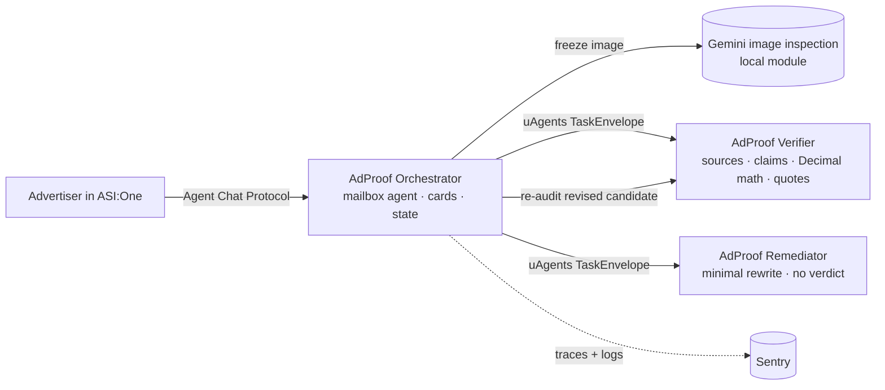

# AdProof

**An evidence-backed preflight and repair agent for AI-generated ads, inside ASI:One.**

AI makes a thousand ads cheap. It does not make them true. AdProof checks an ad before launch: it splits the copy into
objective claims, checks each one against the product page with exact quotes, reads the image with Gemini, does the
price math deterministically, proposes one minimal rewrite, and independently re-audits it. Its signature moment:
**rewriting the copy cannot fix an image that still says "Only $49".**

> Bounded prototype. PASS means only that the listed checks found no unresolved issue in the supplied sources.
> Not legal advice, not Google Ads approval, not a CTR predictor.

## What it does (AeroBeat demo)

| Ad says | Product page says | AdProof |
|---|---|---|
| "completely waterproof" | "Not waterproof" | Contradicted, with the quote |
| "48-hour battery life with noise cancellation off" | "Up to 30 hours … with noise cancellation off" | Contradicted, same condition |
| "Recommended by 1,000 athletes" | nothing | No evidence (not "fake") |
| "Now $60" | "Now $60.00" | Supported |
| "50% off" | $80 → $60 | (80 − 60) / 80 × 100 = **25%**, contradicted |

One repair → *"Meet AeroBeat AB-01 headphones: splash-resistant, with up to 30 hours of battery life when noise
cancellation is off. Now $60, down from $80—25% off."* → re-audited → **PASS** (neutral image) or **still FIX REQUIRED**
(image says "Only $49").

## Architecture: three real agents



- **Orchestrator** (`agents/orchestrator`): the public ASI:One agent. Intake, image freezing, Gemini inspection,
  dispatch, one repair, report, Interactive Cards, ownership and idempotency.
- **Verifier** (`agents/verifier`): fetches the supplied page safely, extracts claims, validates every quote against the
  page text, computes prices/discounts with `Decimal`, decides with fixed precedence rules (no LLM decides).
- **Remediator** (`agents/remediator`): proposes the smallest rewrite from validated evidence. It never decides PASS;
  a deterministic guard rejects rewrites that invent prices or percentages.
- Specialists accept tasks **only** from the orchestrator's address; replies are correlated by task, candidate and phase.

Decision precedence (code, not model): **BLOCK** only for an ACTIVE reviewed rule → **HUMAN REVIEW** for uncertainty,
failed checks, invalid citations or unsupported scope → **FIX REQUIRED** for established issues → **PASS** only when
every required check completed clean.

## Quick start

```bash
python3 -m venv .venv && source .venv/bin/activate
pip install -r requirements.txt
cp .env.example .env            # add GEMINI_API_KEY (and SENTRY_DSN if you have one)
python -m scripts.init_identities   # creates private agent seeds in .env, prints public addresses
python -m pytest                     # 43 offline tests, no keys needed
python -m adproof.demo --case aerobeat --mode mock   # whole workflow in one process, offline
python -m adproof.demo --case trap                    # LIVE: real Gemini (uses ~6 model calls)
python -m scripts.transport_test                      # real 3-agent messaging on localhost
./scripts/run_all.sh                                  # run the three agents for ASI:One
```

Full laptop setup, Agentverse mailbox connection and Sentry: **[docs/setup.md](docs/setup.md)**.

## Talk to it in ASI:One

`help` · `demo aerobeat` · `demo trap` · `demo clean` · `demo blurry` · `demo audit` · `example` ·
`status <audit_id>` · `report <audit_id>`, or send your own ad in the labeled format from `example`.

## Scope and limits

- Google Ads · US · English · adults · consumer electronics. One image (PNG/JPEG ≤ 8 MiB), copy ≤ 4096 chars, one page.
- Public HTTPS sources on allowed hosts only (default `raw.githubusercontent.com`); SSRF-checked, size-bounded.
- Supporting documents are accepted but not yet read (reported as NOT_CHECKED).
- Platform policy entries are cited for context and are **DRAFT** until a human reviews them; they never decide.
- The AeroBeat product, page and images are synthetic.

More: [policy scope](docs/policy-scope.md) · [validation status](docs/validation-status.md) ·
[demo script](docs/demo-script.md) · [observability improvement](docs/observability-improvement.md) ·
[how this was built](docs/HACKATHON_BUILD.md)
